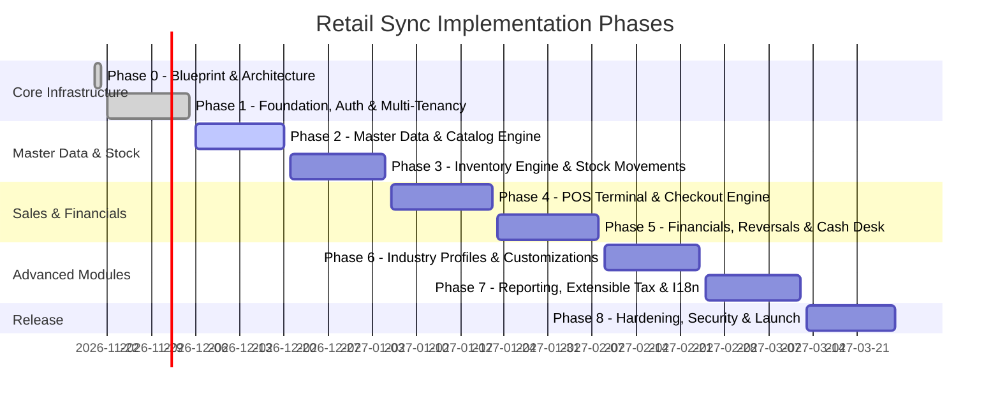

# Retail Sync — Development Roadmap & Milestones

> **Document Status:** Authoritative — Phase 1 Complete  
> **Target Audience:** Product Managers, Technical Leads, Engineering Team  
> **Last Updated:** 2026-11-20  

---

## 1. Phased Implementation Roadmap

Retail Sync follows a disciplined, phase-gated execution plan. Each phase builds upon verified foundations, preventing architectural debt and rework.

---

## 2. Phase Breakdown & Deliverables

### Phase 0: Architecture & Project Blueprint
- **Status:** **COMPLETE & FINALIZED**
- **Deliverables:** System topology, database schema, security rules blueprint, technical specifications, and development roadmap.

---

### Phase 1: Foundation, Tooling, Authentication & Multi-Tenancy
- **Status:** **COMPLETE**
- **Objectives:** Establish project repository, build pipelines, Firebase Emulators, and tenant provisioning.
- **Implemented Key Deliverables:**
  - Clean monorepo structure: React 18 + Vite + TypeScript + Tailwind CSS (in `src/`), Firebase Cloud Functions v2 (in `functions/`).
  - Firebase Local Emulator configuration (Auth, Firestore, Functions, Storage, Emulator UI) with safe demo seed data script (`scripts/seed-emulator.js`).
  - Firebase Authentication: email/password registration, login, logout, password reset, session restoration, and user profile sync (`/users/{userId}`).
  - Multi-tenant Organization provisioning via trusted Cloud Function (`provisionOrganization`), atomic creation of organization, primary store, and owner membership.
  - Organization-level Fiscal Year configuration: Defaults to April 1 to March 31 (Indian Financial Year) with January 1 to December 31 alternative; locked post-invoice.
  - Held Bill expiration policy: Defaults to 24 hours, configurable 1–72 hours; authoritative application rejection; Firestore TTL as eventual cleanup.
  - Authoritative membership and RBAC (`/userMemberships/{userId}_{orgId}`): roles (`OWNER`, `MANAGER`, `CASHIER`, `INVENTORY_MANAGER`, `ACCOUNTANT`), status (`ACTIVE`, `INVITED`, `SUSPENDED`), store-level scoping, and invite workflow.
  - Restrictive Firestore Security Rules (`firestore.rules`) blocking direct client writes to financial/stock/counter collections.
  - Comprehensive automated test suite: 21 unit tests covering auth, schemas, and RBAC, plus Firebase Security Rules tests.
- **Exit Criteria:** PASS. Zero TypeScript errors, passing unit tests, verified build pipelines, and working emulator seed.

---

### Phase 2: Master Data Management (Catalog, Variants, UoM)
- **Status:** **PENDING PHASE 1 APPROVAL**
- **Objectives:** Implement the centralized Product Information Management (PIM) system.
- **Key Deliverables:**
  - Category and Brand management CRUD.
  - Unit of Measurement (UoM) conversion tables (Base UoM vs. Secondary UoM).
  - Matrix Variant generator (Size × Color × Style) with automated SKU/barcode generation.
  - Dynamic industry-specific attributes (HSN codes, fabric details, wattage).
  - Fast barcode uniqueness verification and composite indexing.

---

### Phase 3: Inventory Engine & Stock Movements
- **Status:** Planned
- **Objectives:** Build real-time decentralized store stock tracking with immutable audit logging.

---

### Phase 4: POS Terminal & Atomic Checkout Engine
- **Status:** Planned
- **Objectives:** Deliver high-speed cashier POS terminal with trusted server checkout.

---

### Phase 5: Financials, Reversals, Customer Khata & Cash Desk
- **Status:** Planned
- **Objectives:** Implement cash drawer controls, customer credit ledgers, and immutable reversal workflows.

---

### Phase 6: Industry-Specific Modules & Customizations
- **Status:** Planned
- **Objectives:** Activate vertical-specific business rules without code duplication.

---

### Phase 7: Reporting, Extensible Tax Architecture & Localization
- **Status:** Planned
- **Objectives:** Deliver business intelligence, extensible tax reporting, and multilingual accessibility.

---

### Phase 8: Hardening, Performance, Security Audit & Launch
- **Status:** Planned
- **Objectives:** Production readiness, load testing, security rule unit testing, and deployment.
