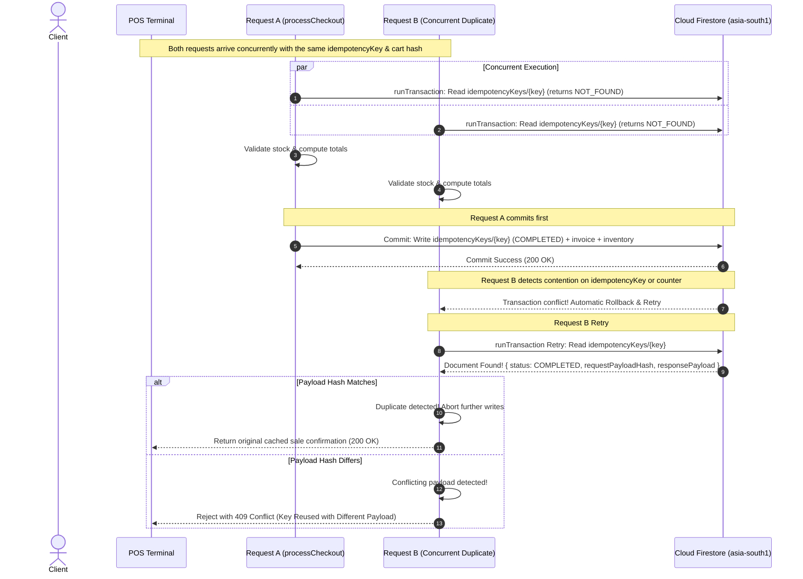

# Retail Sync — Cloud Firestore Database Design

> **Document Status:** Complete & Authoritative (Phase 0 — Final Sign-Off)  
> **Target Audience:** Database Engineers, Backend Architects, Full-Stack Developers  
> **Last Updated:** 2026-11-20  

---

## 1. Firestore Architecture Principles & Constraints

Cloud Firestore is a horizontally scalable, document-oriented NoSQL database. Designing for Firestore requires fundamentally different paradigms than traditional relational engines (PostgreSQL/MySQL):

1. **No Relational JOINs:** Related entities must be queried independently or prudently denormalized. Static data needed for historical records (e.g., product name, SKU, tax rate at the time of sale) **must be embedded** inside the transaction document to preserve historical integrity.
2. **Document Contention & Write Rate Realities:** Firestore documents support ~1 write per second sustained throughput. High-frequency concurrent mutations on a single document trigger contention and transaction aborts (`FAILED_PRECONDITION: contention`). Firestore transactions automatically retry up to 5 times with exponential backoff before failing.
3. **Transaction Operational Boundaries:**
   - **Strict Read-Before-Write Order:** All document reads must execute before any write mutations are staged.
   - **Side-Effect Free Callbacks:** Because transaction callbacks can execute multiple times during contention retries, callbacks must be pure and must **never** trigger external network calls (e.g., payment gateways, SMS notifications).
   - **Cart Size & Document Limit:** Maximum 500 documents written per transaction and 10 MB payload ceiling. A standard retail POS checkout is strictly bounded to **up to 100 line items** per transaction, guaranteeing that total document reads and writes remain well below the 500-operation limit. Bulk wholesale orders (> 100 items) utilize multi-batch staged operations.
4. **Document Size Constraint:** Hard limit of 1 MiB (1,048,576 bytes) per document. Standard retail sales (< 100 items) embed line items directly while remaining under 50 KiB.

---

## 2. Standardized Multi-Tenant Collection Hierarchy

All tenant and store-level documents follow a strictly standardized **Organization-Rooted Hierarchy**:

```
/users/{userId}                                                     [Global User Registry]
/userMemberships/{userId}_{orgId}                                   [Global Membership Lookup - Authoritative]
/organizations/{orgId}                                              [Tenant Root]
  ├── /stores/{storeId}                                             [Store Profile]
  │     ├── /inventory/{variantId}                                  [Store Stock Balances]
  │     ├── /sales/{saleId}                                         [Sale & Invoices - Immutable]
  │     ├── /counters/{counterKey}                                  [Store Transaction Counters]
  │     ├── /cashDrawers/{drawerSessionId}                          [Cash Drawer Shifts]
  │     └── /heldBills/{heldBillId}                                 [Parked Carts - No Stock Lock]
  ├── /products/{productId}                                         [Organization Master Catalog]
  │     └── /variants/{variantId}                                   [Product Variants / SKUs (Public Pricing)]
  │           └── /restrictedPricing/{docId}                        [Protected Landed Cost & Margins - Admin Only]
  ├── /categories/{categoryId}                                      [Catalog Taxonomies]
  ├── /brands/{brandId}                                             [Brand Directory]
  ├── /unitsOfMeasure/{uomId}                                       [UoM & Conversion Factors]
  ├── /suppliers/{supplierId}                                       [Supplier Directory]
  ├── /purchaseOrders/{poId}                                        [Procurement Orders]
  ├── /goodsReceiptNotes/{grnId}                                    [Inventory Receipts (GRN)]
  ├── /customers/{customerId}                                       [Customer Master & Ledger]
  │     └── /ledgerEntries/{entryId}                                [Customer Khata Transactions]
  ├── /stockMovements/{movementId}                                  [Immutable Stock Audit Trail]
  ├── /idempotencyKeys/{idempotencyKey}                             [Checkout Deduplication Keys]
  └── /auditLogs/{logId}                                            [Security & System Audit]
```

### Collection Ownership & Permitted Write Authority

| Collection Path | Logical Owner | Client Direct Write? | Backend Admin SDK Write? |
| :--- | :--- | :--- | :--- |
| `/users/{userId}` | User / Auth | Allowed (Self profile only) | Allowed |
| `/userMemberships/{userId}_{orgId}` | Organization Admin | **FORBIDDEN (allow write: false)** | **Allowed (Authoritative)** |
| `/organizations/{orgId}` | Tenant Owner | Allowed (Owner only) | Allowed |
| `/organizations/{orgId}/stores/{storeId}` | Organization Owner | Allowed (Owner only) | Allowed |
| `/organizations/{orgId}/stores/{sId}/inventory/{vId}` | Store Inventory | **FORBIDDEN (allow write: false)** | **Allowed (Atomic Functions)** |
| `/organizations/{orgId}/stores/{sId}/sales/{saleId}` | Financial Ledger | **FORBIDDEN (allow write: false)** | **Allowed (Atomic Functions)** |
| `/organizations/{orgId}/stores/{sId}/counters/{cKey}`| Sequential Engine | **FORBIDDEN (allow write: false)** | **Allowed (Atomic Functions)** |
| `/organizations/{orgId}/stores/{sId}/heldBills/{id}` | POS Cashier | Allowed (Assigned Store Cashier) | Allowed |
| `/organizations/{orgId}/stores/{sId}/cashDrawers/{id}`| Cashier / Shift | **FORBIDDEN (allow write: false)** | Allowed (Shift Cloud Functions)|
| `/organizations/{orgId}/products/{productId}` | Catalog Admin | Allowed (Manager/Owner) | Allowed |
| `/organizations/{orgId}/products/{pId}/variants/{vId}`| Catalog Admin | Allowed (Manager/Owner) | Allowed |
| `/organizations/{orgId}/stockMovements/{movementId}` | Inventory Ledger| **FORBIDDEN (allow write: false)** | **Allowed (Append-Only SDK)** |
| `/organizations/{orgId}/idempotencyKeys/{key}` | Checkout Engine | **FORBIDDEN (allow write: false)** | **Allowed (Atomic Functions)** |
| `/organizations/{orgId}/auditLogs/{logId}` | Security System | **FORBIDDEN (allow write: false)** | **Allowed (Append-Only SDK)** |

---

## 3. Detailed Data Schemas & Entity Definitions

### 3.1 Global Routing Entities

#### Collection: `/users/{userId}`
```typescript
interface UserProfileDocument {
  id: string; // matches Firebase Auth UID
  email: string;
  phoneNumber?: string;
  displayName: string;
  isActive: boolean;
  defaultOrganizationId?: string;
  createdAt: FirebaseFirestore.Timestamp;
  updatedAt: FirebaseFirestore.Timestamp;
}
```

#### Collection: `/userMemberships/{userId}_{orgId}` *(Authoritative)*
```typescript
interface UserMembershipDocument {
  id: string; // format: `${userId}_${orgId}`
  userId: string;
  organizationId: string;
  role: "OWNER" | "STORE_MANAGER" | "CASHIER" | "INVENTORY_CLERK" | "ACCOUNTANT";
  assignedStoreIds: string[]; // empty array denotes all stores in organization
  permissions: string[]; // granular permission overrides e.g. ["sales:checkout", "sales:refund"]
  status: "ACTIVE" | "INVITED" | "SUSPENDED";
  invitedBy: string;
  createdAt: FirebaseFirestore.Timestamp;
  updatedAt: FirebaseFirestore.Timestamp;
}
```

---

### 3.2 Organization & Store Configuration

#### Collection: `/organizations/{orgId}`
```typescript
interface OrganizationDocument {
  id: string;
  legalName: string;
  tradeName: string;
  industryProfile: "GROCERY" | "TEXTILE" | "HARDWARE" | "ELECTRICAL" | "WHOLESALE" | "GENERAL";
  // Organization-level Fiscal Year Configuration
  fiscalYearSettings: {
    type: "APRIL_TO_MARCH" | "JANUARY_TO_DECEMBER"; // Default: APRIL_TO_MARCH
    customStartMonth?: number; // 4 for April, 1 for January
    isLocked: boolean; // Set to true once the first invoice is issued
  };
  // Organization-level Held Bill Policy
  heldBillSettings: {
    expirationHours: number; // Default: 24, System Minimum: 1, System Maximum: 72
  };
  taxSettings: {
    regime: "INDIA_GST" | "GENERIC_VAT" | "CUSTOM";
    taxIdentificationNumber?: string; // e.g. GSTIN
    defaultTaxRatePercent: number;
    pricesIncludeTax: boolean;
  };
  currencyCode: "INR" | string;
  timezone: string; // e.g., "Asia/Kolkata"
  featuresEnabled: {
    batchExpiryTracking: boolean;
    serialNumberTracking: boolean;
    dualUnitOfMeasurement: boolean;
    customerKhataLedger: boolean;
    matrixVariants: boolean;
    loyaltyPoints: boolean;
  };
  ownerUserId: string;
  subscriptionPlan: "TRIAL" | "PRO" | "ENTERPRISE";
  createdAt: FirebaseFirestore.Timestamp;
  updatedAt: FirebaseFirestore.Timestamp;
}
```

#### Collection: `/organizations/{orgId}/stores/{storeId}`
```typescript
interface StoreDocument {
  id: string;
  organizationId: string;
  storeCode: string; // e.g., "MUM01" used for invoice prefixes
  name: string;
  address: {
    street: string;
    city: string;
    state: string;
    postalCode: string;
    country: string;
  };
  contactPhone: string;
  invoiceSettings: {
    prefix: string; // e.g., "RS/MUM01/2026-27/"
    headerText?: string;
    footerText?: string;
    taxInvoiceTitle: string; // e.g. "Tax Invoice"
    termsAndConditions?: string;
  };
  isActive: boolean;
  createdAt: FirebaseFirestore.Timestamp;
  updatedAt: FirebaseFirestore.Timestamp;
}
```

---

### 3.3 Catalog & Variant Models

#### Collection: `/organizations/{orgId}/products/{productId}`
```typescript
interface ProductDocument {
  id: string;
  organizationId: string;
  name: string;
  slug: string;
  categoryId: string;
  brandId?: string;
  baseUomId: string; // e.g. "kg", "pcs"
  secondaryUomId?: string;
  uomConversionFactor?: number; // e.g., 1 Box = 12 Pieces
  hasVariants: boolean;
  taxData?: {
    hsnCode?: string; // India GST HSN/SAC code
    taxCategory?: "STANDARD" | "EXEMPT" | "ZERO_RATED";
  };
  status: "ACTIVE" | "ARCHIVED";
  createdAt: FirebaseFirestore.Timestamp;
  updatedAt: FirebaseFirestore.Timestamp;
}
```

#### Collection: `/organizations/{orgId}/products/{productId}/variants/{variantId}`
```typescript
interface ProductVariantDocument {
  id: string;
  productId: string;
  organizationId: string;
  sku: string;
  barcode: string;
  additionalBarcodes?: string[];
  attributeValues: Record<string, string>; // e.g., { "Size": "XL", "Color": "Navy Blue" }
  pricing: {
    mrp: number; // Maximum Retail Price (paise)
    sellingPrice: number; // Authoritative Base Selling Price (paise)
  };
  taxRatePercent: number; // e.g., 0.0, 5.0, 12.0, 18.0, 28.0
  trackInventory: boolean;
  reorderPoint: number;
  status: "ACTIVE" | "INACTIVE" | "ARCHIVED";
  createdAt: FirebaseFirestore.Timestamp;
  updatedAt: FirebaseFirestore.Timestamp;
}
```

#### Subcollection: `/organizations/{orgId}/products/{productId}/variants/{variantId}/restrictedPricing/current`
*(Restricted to OWNER and MANAGER roles only. Stripped from public variant reads to protect gross margins)*
```typescript
interface RestrictedVariantPricingDocument {
  id: "current";
  organizationId: string;
  productId: string;
  variantId: string;
  costPrice: number; // Authoritative Landed Cost in integer minor units (paise)
  wholesalePrice?: number | null; // Optional wholesale tier in integer minor units (paise)
  minimumSellingPrice?: number | null; // Optional floor price in integer minor units (paise)
  createdAt: FirebaseFirestore.Timestamp;
  updatedAt: FirebaseFirestore.Timestamp;
}
```

---

### 3.4 Inventory Balances & Stock Movement Ledger

#### Collection: `/organizations/{orgId}/stores/{storeId}/inventory/{variantId}`
```typescript
interface StoreInventoryDocument {
  id: string; // matches variantId
  organizationId: string;
  storeId: string;
  productId: string;
  variantId: string;
  sku: string;
  barcode: string;
  onHandQuantity: number;
  reservedQuantity: number;
  availableQuantity: number; // onHand - reserved (Authoritative check at checkout)
  batches?: Array<{
    batchNumber: string;
    expiryDate: FirebaseFirestore.Timestamp;
    quantity: number;
  }>;
  serialsAvailable?: string[];
  lastRestockedAt?: FirebaseFirestore.Timestamp;
  updatedAt: FirebaseFirestore.Timestamp;
}
```

#### Collection: `/organizations/{orgId}/stockMovements/{movementId}` *(Immutable Ledger)*
```typescript
interface StockMovementDocument {
  id: string;
  organizationId: string;
  storeId: string;
  variantId: string;
  productId: string;
  movementType: "SALE" | "SALE_RETURN" | "PURCHASE_RECEIPT" | "TRANSFER_IN" | "TRANSFER_OUT" | "ADJUSTMENT_DAMAGE" | "ADJUSTMENT_INVENTORY_COUNT";
  referenceType: "SALE_INVOICE" | "GRN" | "TRANSFER_ORDER" | "STOCK_AUDIT";
  referenceId: string; // points to saleId, grnId, etc.
  quantityDelta: number; // negative for reduction (-2), positive for addition (+10)
  previousBalance: number;
  newBalance: number;
  unitCost: number;
  batchNumber?: string;
  serialNumbers?: string[];
  performedByUserId: string;
  notes?: string;
  createdAt: FirebaseFirestore.Timestamp; // immutable server timestamp
}
```

---

### 3.5 Sales, Invoices & Transaction Entities

#### Collection: `/organizations/{orgId}/stores/{storeId}/sales/{saleId}` *(Immutable Financial Record)*
```typescript
interface SaleDocument {
  id: string; // UUIDv4
  organizationId: string;
  storeId: string;
  invoiceNumber: string; // e.g., "RS/MUM01/2026-27/000452"
  fiscalYear: string; // e.g., "2026-2027" or "2026"
  customerId?: string;
  cashierUserId: string;
  drawerSessionId: string;
  status: "POSTED" | "REVERSED" | "PARTIALLY_REVERSED";
  itemCount: number; // bounded to <= 100 for standard retail POS
  totalQuantity: number;
  pricing: {
    grossSubtotal: number;
    totalDiscountAmount: number;
    taxableAmount: number;
    totalTaxAmount: number;
    taxBreakdown: Array<{
      taxType: "CGST" | "SGST" | "IGST" | "VAT" | "SURCHARGE";
      ratePercent: number;
      taxableAmount: number;
      taxAmount: number;
    }>;
    roundOffAmount: number;
    finalNetTotal: number;
  };
  payments: Array<{
    method: "CASH" | "CARD" | "UPI" | "KHATA_CREDIT" | "STORE_CREDIT_VOUCHER";
    amount: number;
    referenceCode?: string; // Manual cashier reference note; NOT gateway-verified
    verificationStatus: "UNVERIFIED_MANUAL" | "VERIFIED_GATEWAY";
    capturedAt: FirebaseFirestore.Timestamp;
  }>;
  items: Array<{
    variantId: string;
    productId: string;
    productName: string;
    sku: string;
    barcode: string;
    unitName: string;
    quantity: number;
    unitPrice: number; // Authoritative price snapshot
    discountAmount: number;
    taxRatePercent: number;
    taxAmount: number;
    netLineTotal: number;
    batchNumber?: string;
    serialNumbers?: string[];
  }>;
  idempotencyKey: string;
  reversalReason?: string;
  reversedSaleId?: string; // pointer to compensatory credit note document
  createdAt: FirebaseFirestore.Timestamp; // Immutable creation timestamp
}
```

#### Collection: `/organizations/{orgId}/stores/{storeId}/counters/invoices_{fiscalYear}`
```typescript
interface StoreInvoiceCounterDocument {
  currentSequenceNumber: number; // Incremented inside runTransaction
  fiscalYear: string; // e.g. "2026-2027" or "2026"
  updatedAt: FirebaseFirestore.Timestamp;
}
```

#### Collection: `/organizations/{orgId}/idempotencyKeys/{idempotencyKey}`
```typescript
interface IdempotencyKeyDocument {
  id: string; // UUIDv4 idempotencyKey
  organizationId: string;
  storeId: string;
  requestPayloadHash: string; // SHA-256 hash of items array + tendered amounts
  saleId: string;
  responsePayload: {
    saleId: string;
    invoiceNumber: string;
    finalNetTotal: number;
    timestamp: string;
  };
  createdAt: FirebaseFirestore.Timestamp;
  expiresAt: FirebaseFirestore.Timestamp; // 7-day TTL for eventual storage purge
}
```

#### Collection: `/organizations/{orgId}/stores/{storeId}/heldBills/{heldBillId}`
```typescript
interface HeldBillDocument {
  id: string;
  organizationId: string;
  storeId: string;
  cashierUserId: string;
  customerName?: string;
  customerPhone?: string;
  items: Array<{
    variantId: string;
    quantity: number;
    provisionalPrice: number;
  }>;
  heldAt: FirebaseFirestore.Timestamp;
  expiresAt: FirebaseFirestore.Timestamp; // Calculated: heldAt + (organization.heldBillSettings.expirationHours)
}
```

---

## 4. Fiscal Year Configuration & Administration

1. **Organization-Level Configuration:**
   - **Default Fiscal Year:** India Financial Year: **April 1 to March 31** (e.g., `2026-2027`).
   - **Alternative Supported:** Calendar Year: **January 1 to December 31** (e.g., `2026`).
2. **Preservation of Historical Invoice Sequences:**
   - Sequential counter documents are scoped by store and fiscal year key: `/organizations/{orgId}/stores/{storeId}/counters/invoices_{fiscalYear}`.
   - When a fiscal year rolls over, a new counter document is instantiated for the new cycle (e.g., `invoices_2027-2028`), ensuring that historical counter sequences (`invoices_2026-2027`) remain immutable and intact.
3. **Restricted Administrative Changes:**
   - Once an organization issues its first invoice, `fiscalYearSettings.isLocked` is automatically set to `true`.
   - Modifying the fiscal year definition after invoices exist cannot be performed via standard settings screens. It requires authorized administrative handling (elevated tenant owner verification, accounting period audit, and sequence re-anchoring) to prevent sequence collision and accounting corruption.

---

## 5. Held Bill Expiration & Lifecycle Policy

1. **Configurable Expiration:**
   - **Default Expiration:** 24 hours from creation.
   - **Organization Range:** Configurable by the organization owner between **1 hour (minimum)** and **72 hours (system maximum)**.
2. **Authoritative Application Enforcement:**
   - **Retrieval & Resume Gate:** When a cashier attempts to resume or checkout a held bill, the backend/application layer explicitly asserts `currentTime < heldBill.expiresAt`.
   - **Rejection of Expired Bills:** If `currentTime >= heldBill.expiresAt`, the server rejects the checkout attempt with `410 Gone: Held Bill Has Expired`. The items cannot be restored to the cart without fresh catalog and price validation.
3. **Firestore TTL Clarification:**
   - Firestore's native Time-to-Live (TTL) feature on `expiresAt` is utilized **solely for eventual background cleanup and storage cost management**.
   - Because Firestore TTL deletes documents asynchronously (often taking up to 24–48 hours after timestamp expiration), **TTL is not used as the security or business enforcement boundary**. Application-level timestamp checks are strictly authoritative.

---

## 6. Idempotency & Transaction Retry Concurrency Model

### 6.1 Transactional Visibility Realities
Inside Google Cloud Firestore, an uncommitted write is **isolated to that transaction** and is not observable by other concurrent transactions until successfully committed. Therefore, Retail Sync **does not claim that an uncommitted `IN_PROGRESS` state is observable across concurrent transactions without an upfront, non-transactional reservation write**.

### 6.2 Serialization via Contention Retries
Instead, Retail Sync relies on Firestore's native optimistic concurrency and contention retry mechanics to serialize concurrent duplicate requests cleanly:



1. **Resolution of Concurrent Duplicates:**
   - If two identical requests execute concurrently with the same idempotency key, both read the non-existent key.
   - The first request commits, writing `/idempotencyKeys/{key}` with `requestPayloadHash`, `saleId`, and `responsePayload`, alongside the invoice and inventory updates.
   - The second concurrent transaction experiences a document contention conflict on either the idempotency key or the store counter. Firestore automatically rolls back the second transaction and retries.
   - Upon retry, the second transaction reads the committed `/idempotencyKeys/{key}` record.
2. **Outcome Verification:**
   - **Same Key & Matching Payload Hash:** The retried transaction immediately aborts all stock/counter writes and returns the original stored `responsePayload`. Zero duplicate sales are created and no stock is deducted twice.
   - **Same Key & Conflicting Payload Hash:** If the payload hash does not match, the transaction throws `409 Conflict: Idempotency Key Reused with Different Payload`.
