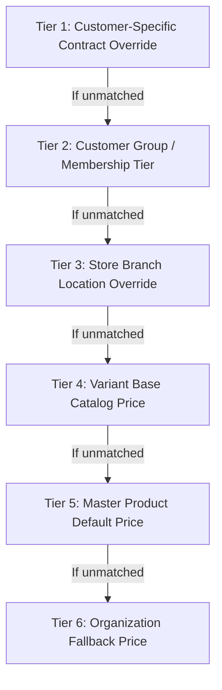

# Retail Sync — Pricing Hierarchy Architecture

> **Document Version:** 1.0.0  
> **Milestone:** Phase 2, Day 5  
> **Status:** Implementation Complete & Validated  
> **Compliance:** Indian Retail Multi-Channel Standard, Zero Floating-Point Currency Arithmetic

---

## 1. Executive Summary

The Retail Sync Pricing Hierarchy Engine delivers a multi-tiered, non-destructive, and deterministic price resolution system designed for high-concurrency retail environments. The engine resolves prices dynamically across organizational structures, retail store branches, customer pricing tiers, and individual customer contracts while guaranteeing that historical catalog base prices are never mutated or corrupted.

All monetary amounts are strictly maintained as **integer minor units** (paise in INR, cents in USD/EUR), eliminating IEEE 754 floating-point arithmetic errors across calculations, discounts, and database writes.

---

## 2. Six-Tier Pricing Precedence Model

When a retail pricing query is initiated (e.g., during POS item scanning, catalog browsing, or order preparation), the engine evaluates active rules according to a strict 6-tier precedence hierarchy:



### 2.1 Resolution Hierarchy Tiers

| Precedence Tier | Pricing Level | Target Entity | Use Case |
| :---: | :--- | :--- | :--- |
| **Tier 1 (Highest)** | `CUSTOMER` | `customerId` | Special negotiated contracts, institutional B2B pricing, VIP client pricing. |
| **Tier 2** | `CUSTOMER_GROUP` | `customerGroupId` | Wholesale tiers, distributor loyalty groups, employee discounts. |
| **Tier 3** | `STORE` | `storeId` | Location-specific pricing (e.g., airport branch vs. highway vs. downtown flagship store). |
| **Tier 4** | `VARIANT` | `variantId` | Specific matrix SKU pricing (e.g., Size XXL surcharge, premium color variant). |
| **Tier 5** | `PRODUCT` | `productId` | Master product default selling price applicable to all variants. |
| **Tier 6 (Lowest)** | `ORGANIZATION` | `organizationId` | Universal base price for the tenant. |

### 2.2 Date Interval Activation & Expiration
Every pricing rule maintains an effective interval:
- `effectiveStartDate`: ISO 8601 UTC timestamp. Rule is inactive prior to this timestamp.
- `effectiveEndDate`: Optional ISO 8601 UTC timestamp. If present, rule expires when current evaluation time $> \text{effectiveEndDate}$.
- `status`: Must be `'ACTIVE'`. Archived rules are immediately ignored during resolution.

---

## 3. Money & Currency Architecture (Integer Minor Units)

### 3.1 Strict Integer Invariant
- **Paise Representation**: ₹100.50 is stored as integer `10050`. ₹0.01 is `1`.
- **Zero Floating-Point Storage**: No floating-point numbers are persisted in Firestore for currency fields.
- **Safe Integer Limits**: Bounds checked against `Number.MAX_SAFE_INTEGER` ($9,007,199,254,740,991$ minor units $\approx ₹90\text{ Trillion}$).
- **Banker's / Commercial Half-Up Rounding**: Conversion from major units or fractional tax multipliers applies `Math.round(val)` to avoid downward truncations.

### 3.2 Price Relationship Invariants
The engine asserts logical consistency across all price components:

$$\text{costPrice} \le \text{sellingPrice} \le \text{mrp}$$
$$\text{minimumSellingPrice} \le \text{sellingPrice}$$
$$\text{wholesalePrice} \le \text{mrp}$$

If an update violates these bounds (e.g., selling price exceeding legal MRP), the transaction aborts with a descriptive `ValidationError`.

---

## 4. Role-Based Price Field Redaction

To safeguard wholesale purchasing margins and internal landed costs from front-line personnel:
- When `getEffectivePrice` is called by a user with role `CASHIER`, `costPriceMinor` is automatically redacted (`undefined`).
- Roles `OWNER`, `MANAGER`, and `STORE_MANAGER` retain full access to landed `costPriceMinor` for margin analytics.

---

## 5. Immutable Price & Tax Snapshots

Sales invoices, register receipts, and orders must never rely on live catalog pointers because catalog prices may change post-sale. 

The `createPriceAndTaxSnapshot` function produces an immutable frozen record (`PriceAndTaxSnapshot`):

```typescript
export interface PriceAndTaxSnapshot {
  productId: string;
  variantId?: string;
  productName: string;
  sku: string;
  barcode?: string;
  pricingLevel: 'ORGANIZATION' | 'STORE' | 'PRODUCT' | 'VARIANT' | 'CUSTOMER_GROUP' | 'CUSTOMER';
  pricingSourceRuleId?: string;
  unitPriceMinor: number;
  discountMinor: number;
  netTaxableAmountMinor: number;
  pricingType: 'TAX_INCLUSIVE' | 'TAX_EXCLUSIVE';
  taxRatePercent: number;
  taxClassificationCode?: string;
  taxComponents: TaxComponentBreakdown[];
  totalTaxAmountMinor: number;
  finalAmountMinor: number;
  currency: string;
  originStateCode: string;
  destinationStateCode: string;
  calculatedAt: string;
}
```

This guarantees 100% audit compliance for downstream accounting and tax filings.
