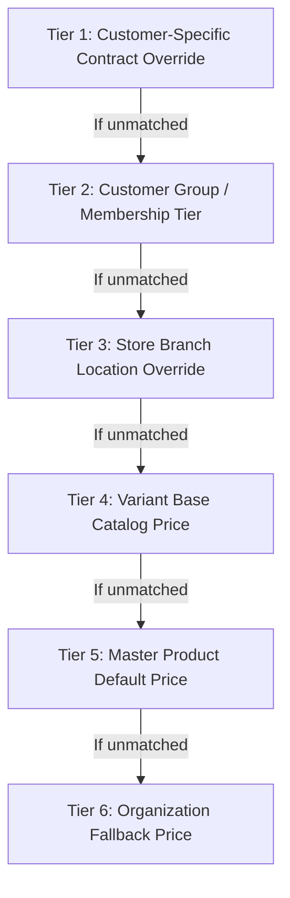

# Retail Sync — Pricing Hierarchy Architecture

> **Document Version:** 1.0.0  
> **Milestone:** Phase 2, Day 5  
> **Status:** Implementation Complete & Validated  
> **Compliance:** Indian Retail Multi-Channel Standard, Zero Floating-Point Currency Arithmetic

---

## 1. Executive Summary

The Retail Sync Pricing Hierarchy Engine delivers a multi-tiered, non-destructive, and deterministic price resolution system designed for high-concurrency retail environments. The engine resolves prices dynamically across organizational structures, retail store branches, customer pricing tiers, and individual customer contracts while guaranteeing that historical catalog base prices are never mutated or corrupted.

All monetary amounts are strictly maintained as **integer minor units** (paise in INR, cents in USD/EUR), eliminating IEEE 754 floating-point arithmetic errors across calculations, discounts, and database writes.

---

## 2. Six-Tier Pricing Precedence Model

When a retail pricing query is initiated (e.g., during POS item scanning, catalog browsing, or order preparation), the engine evaluates active rules according to a strict 6-tier precedence hierarchy:



### 2.1 Resolution Hierarchy Tiers

| Precedence Tier | Pricing Level | Target Entity | Use Case |
| :---: | :--- | :--- | :--- |
| **Tier 1 (Highest)** | `CUSTOMER` | `customerId` | Special negotiated contracts, institutional B2B pricing, VIP client pricing. |
| **Tier 2** | `CUSTOMER_GROUP` | `customerGroupId` | Wholesale tiers, distributor loyalty groups, employee discounts. |
| **Tier 3** | `STORE` | `storeId` | Location-specific pricing (e.g., airport branch vs. highway vs. downtown flagship store). |
| **Tier 4** | `VARIANT` | `variantId` | Specific matrix SKU pricing (e.g., Size XXL surcharge, premium color variant). |
| **Tier 5** | `PRODUCT` | `productId` | Master product default selling price applicable to all variants. |
| **Tier 6 (Lowest)** | `ORGANIZATION` | `organizationId` | Universal base price for the tenant. |

### 2.2 Date Interval Activation & Expiration
Every pricing rule maintains an effective interval:
- `effectiveStartDate`: ISO 8601 UTC timestamp. Rule is inactive prior to this timestamp.
- `effectiveEndDate`: Optional ISO 8601 UTC timestamp. If present, rule expires when current evaluation time $> \text{effectiveEndDate}$.
- `status`: Must be `'ACTIVE'`. Archived rules are immediately ignored during resolution.

---

## 3. Money & Currency Architecture (Integer Minor Units)

### 3.1 Strict Integer Invariant
- **Paise Representation**: ₹100.50 is stored as integer `10050`. ₹0.01 is `1`.
- **Zero Floating-Point Storage**: No floating-point numbers are persisted in Firestore for currency fields.
- **Safe Integer Limits**: Bounds checked against `Number.MAX_SAFE_INTEGER` ($9,007,199,254,740,991$ minor units $\approx ₹90\text{ Trillion}$).
- **Banker's / Commercial Half-Up Rounding**: Conversion from major units or fractional tax multipliers applies `Math.round(val)` to avoid downward truncations.

### 3.2 Price Relationship Invariants & Below-Cost Sales Policy
The engine validates commercial and statutory price boundaries via `validatePriceRelationship`:

1. **Maximum Retail Price (MRP) Ceilings (Statutory):**
   $$\text{sellingPrice} \le \text{mrp} \quad (\text{when } \text{mrp} > 0)$$
   $$\text{wholesalePrice} \le \text{mrp} \quad (\text{when } \text{mrp} > 0)$$
   Enforces legal compliance under the Indian Legal Metrology (Packaged Commodities) Rules: goods cannot be sold or offered at a base price exceeding the printed MRP.

2. **Price Floor Integrity:**
   $$\text{minimumSellingPrice} \le \text{sellingPrice}$$
   Prevents accidental front-line discounting below the authorized floor price.

3. **Below-Cost / Clearance Pricing Permitted:**
   The system deliberately does **NOT** enforce $\text{costPrice} \le \text{sellingPrice}$. Selling below purchase cost (such as seasonal clearances, perishable stock liquidations, loss-leader promotions, or distressed inventory sales) is fully permitted by the software, subject to the organization's commercial policies and manager authorization controls.

---

## 4. Role-Based Price Field Redaction & History Access

To safeguard wholesale purchasing margins and internal landed costs from unauthorized personnel:
- **`getEffectivePrice` Cloud Function:** When called by a user with role `CASHIER`, `costPriceMinor` is automatically redacted (`undefined`).
- **`pricingHistory` Audit Trail:** Both direct Firestore reads (`/organizations/{orgId}/pricingHistory`) and the backend `getPricingHistory` callable are strictly restricted to **`OWNER`** and **`MANAGER`** roles. Roles `CASHIER`, `INVENTORY_MANAGER`, and `ACCOUNTANT` are denied access to pricing history to prevent exposure of historical purchase costs and margin changes.

---

## 5. Trade Discount Deductibility & Statutory Boundaries (Section 15 CGST Act)

Financial calculations in Retail Sync distinguish between discount types:

1. **Pre-Supply and At-Supply Discounts (Section 15(3)(a)):**
   Discounts given *before or at the time of supply* and duly recorded on the invoice face (trade discounts, line discounts, promotional percent/amount deductions) **are legally deductible** from the transaction value to arrive at the net taxable value for GST computation. This is the sole discount model implemented in Phase 2.

2. **Post-Supply Discounts (Section 15(3)(b) Statutory Warning):**
   Discounts granted *after the supply* (such as retrospective turnover rebates, volume targets, or early cash settlement discounts) are legally deductible from taxable value **ONLY IF**:
   - The discount is established in terms of an agreement entered into at or before the time of supply and specifically linked to the relevant invoices, AND
   - Input Tax Credit (ITC) attributable to the discount has been formally reversed by the recipient on the basis of a credit note issued by the supplier.
   
> [!CAUTION]
> Downstream POS and invoicing code (Phase 4) is **strictly prohibited** from treating generic post-supply rebates, credit notes, or cash discounts as an automatic taxable-value deduction without verification of prior contractual agreement and recipient ITC reversal. Full business and tax compliance cannot be claimed without these statutory checks.

---

## 6. Immutable Price & Tax Snapshots

Sales invoices, register receipts, and orders must never rely on live catalog pointers because catalog prices may change post-sale. 

The `createPriceAndTaxSnapshot` function produces an immutable frozen record (`PriceAndTaxSnapshot`):

```typescript
export interface PriceAndTaxSnapshot {
  productId: string;
  variantId?: string;
  productName: string;
  sku: string;
  barcode?: string;
  pricingLevel: 'ORGANIZATION' | 'STORE' | 'PRODUCT' | 'VARIANT' | 'CUSTOMER_GROUP' | 'CUSTOMER';
  pricingSourceRuleId?: string;
  unitPriceMinor: number;
  discountMinor: number;
  netTaxableAmountMinor: number;
  pricingType: 'TAX_INCLUSIVE' | 'TAX_EXCLUSIVE';
  taxRatePercent: number;
  taxClassificationCode?: string;
  taxComponents: TaxComponentBreakdown[];
  totalTaxAmountMinor: number;
  finalAmountMinor: number;
  currency: string;
  originStateCode: string;
  destinationStateCode: string;
  calculatedAt: string;
}
```

This guarantees 100% audit compliance for downstream accounting and tax filings.
