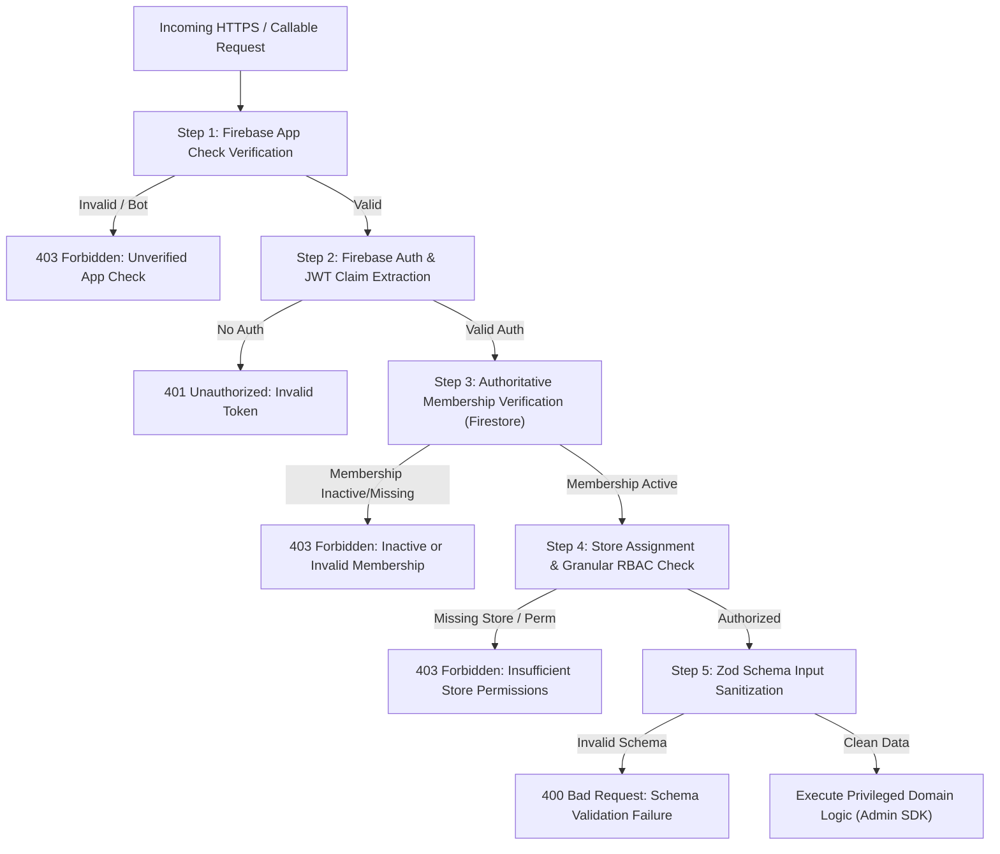

# Retail Sync — Security Architecture

> **Document Status:** Complete & Authoritative (Phase 0 — Final Sign-Off)  
> **Target Audience:** Security Engineers, Backend Architects, Compliance Officers  
> **Last Updated:** 2026-11-20  

---

## 1. Zero-Trust Security Philosophy

Retail Sync enforces a strict **Zero-Trust Security Model**:
1. **The Client is Untrusted:** The web browser runtime is treated as an insecure, potentially hostile environment. No client-supplied prices, discount overrides, tax rates, inventory counts, or organization/store IDs are trusted without authoritative server-side verification.
2. **Authoritative Database Records Over Client JWT Claims:**
   - Firebase Authentication JWT Custom Claims provide convenient hints for fast client-side routing, but they **are not authoritative** on the server. Tokens can be stale (up to 1 hour before refresh) or spoofed if compromised.
   - The authoritative source of truth for all privileged operations is the server-side document: `/userMemberships/{userId}_{orgId}`.
3. **Double-Barreled Authorization:** 
   - Layer 1: **Cloud Firestore Security Rules** guard direct client-to-database read queries.
   - Layer 2: **Backend Service Guards** in Firebase Cloud Functions v2 enforce explicit RBAC and tenant validation for every write, mutation, and sensitive calculation.
4. **The Firebase Admin SDK Privilege Trap:** The Firebase Admin SDK operates in full administrative mode and completely **bypasses Firestore Security Rules**. Therefore, every Cloud Function must implement an uncompromising authorization guard at the code entry point before touching Firestore or Cloud Storage.

---

## 2. Authentication & Membership Authoritativeness

### 2.1 Role of JWT Custom Claims vs. Membership Document

```
+-------------------------------------------------------------+
| Firebase Auth ID Token (JWT Claims - Supplementary Hint)    |
| {                                                           |
|   "orgId": "org_7f9a2b",                                    |
|   "defaultStoreId": "store_01",                             |
|   "role": "CASHIER",                                        |
|   "tokenVer": 2                                             |
| }                                                           |
+-------------------------------------------------------------+
                               |
                               v (Validated on every privileged Cloud Function call)
+-------------------------------------------------------------+
| Firestore Membership Document (AUTHORITATIVE SOURCE OF TRUTH)|
| /userMemberships/{userId}_{orgId}                           |
| {                                                           |
|   "status": "ACTIVE",                                       |
|   "role": "CASHIER",                                        |
|   "assignedStoreIds": ["store_01"],                         |
|   "permissions": ["sales:checkout", "held_bills:manage"],   |
|   "updatedAt": Timestamp                                    |
| }                                                           |
+-------------------------------------------------------------+
```

1. **JWT Custom Claims** carry minimal routing hints (`orgId`, `defaultStoreId`, `role`, `tokenVer`) to stay strictly within Firebase's 1000-byte token limit.
2. **Backend Authoritative Validation:** On every privileged Cloud Function invocation, the backend:
   - Extracts the authenticated `request.auth.uid`.
   - Fetches `/userMemberships/${uid}_${requestedOrgId}`.
   - Asserts `status === "ACTIVE"` (rejects suspended or pending users immediately).
   - Asserts that `requestedStoreId` is included in `assignedStoreIds` (or user is `OWNER`).
   - Asserts that the required granular permission (e.g., `sales:checkout`) is present.

---

## 3. Role-Based Access Control (RBAC) Matrix

| Granular Permission | Owner | Store Manager | Cashier | Inventory Clerk | Accountant |
| :--- | :---: | :---: | :---: | :---: | :---: |
| `org:manage_settings` | **YES** | NO | NO | NO | NO |
| `org:modify_fiscal_year` | **YES (Locked Post-Invoice)** | NO | NO | NO | NO |
| `stores:manage` | **YES** | NO | NO | NO | NO |
| `users:invite_and_manage` | **YES** | Store-Only | NO | NO | NO |
| `catalog:read` | **YES** | **YES** | **YES** | **YES** | **YES** |
| `catalog:write` | **YES** | **YES** | NO | **YES** | NO |
| `sales:checkout` | **YES** | **YES** | **YES** | NO | NO |
| `sales:apply_manual_discount` | **YES** | **YES** | Limited (<=5%) | NO | NO |
| `sales:issue_refund_or_reversal`| **YES** | **YES** | Requires Manager PIN | NO | NO |
| `inventory:view_balances` | **YES** | **YES** | Assigned Store | **YES** | **YES** |
| `inventory:adjust_and_scrap` | **YES** | **YES** | NO | **YES** | NO |
| `inventory:receive_grn` | **YES** | **YES** | NO | **YES** | NO |
| `cash_drawer:open_close` | **YES** | **YES** | **YES** | NO | NO |
| `reports:financial_summary` | **YES** | Store-Only | NO | NO | **YES** |
| `reports:tax_export` | **YES** | NO | NO | NO | **YES** |

---

## 4. Firestore Security Rules Architecture

The Firestore Security Rules strategy enforces tenant isolation for read operations and **completely locks down write access** for critical financial and inventory paths.

```javascript
rules_version = '2';
service cloud.firestore {
  match /databases/{database}/documents {

    // --- Helper Functions ---
    function isAuthenticated() {
      return request.auth != null;
    }

    function isUser(userId) {
      return isAuthenticated() && request.auth.uid == userId;
    }

    function getCustomClaims() {
      return request.auth.token;
    }

    function belongsToOrg(orgId) {
      return isAuthenticated() && getCustomClaims().orgId == orgId;
    }

    function isOrgOwner(orgId) {
      return belongsToOrg(orgId) && getCustomClaims().role == 'OWNER';
    }

    function hasStoreAccess(orgId, storeId) {
      return belongsToOrg(orgId) && (
        getCustomClaims().role == 'OWNER' ||
        getCustomClaims().defaultStoreId == storeId
      );
    }

    // --- 1. Global User Profiles & Authoritative Memberships ---
    match /users/{userId} {
      allow read, write: if isUser(userId);
    }

    match /userMemberships/{membershipId} {
      allow read: if isAuthenticated() && (
        resource.data.userId == request.auth.uid ||
        belongsToOrg(resource.data.organizationId)
      );
      // Memberships can ONLY be modified by Cloud Functions Admin SDK
      allow write: if false;
    }

    // --- 2. Organization Scope ---
    match /organizations/{orgId} {
      allow read: if belongsToOrg(orgId);
      allow write: if isOrgOwner(orgId);

      // Store Directory & Scoped Subcollections
      match /stores/{storeId} {
        allow read: if belongsToOrg(orgId);
        allow write: if isOrgOwner(orgId);

        // Store Inventory Balances (Direct client write FORBIDDEN)
        match /inventory/{variantId} {
          allow read: if hasStoreAccess(orgId, storeId);
          allow write: if false; // Mutated solely via Cloud Functions
        }

        // Store Sales & Invoices (Direct client write FORBIDDEN)
        match /sales/{saleId} {
          allow read: if hasStoreAccess(orgId, storeId);
          allow write: if false; // Created solely via processCheckout Cloud Function
        }

        // Sequential Counters (Direct client write FORBIDDEN)
        match /counters/{counterKey} {
          allow read: if hasStoreAccess(orgId, storeId);
          allow write: if false;
        }

        // Held Bills (Cashiers can park/resume carts directly for rapid UI)
        match /heldBills/{heldBillId} {
          allow read, write: if hasStoreAccess(orgId, storeId);
        }

        // Cash Drawer Sessions
        match /cashDrawers/{sessionId} {
          allow read: if hasStoreAccess(orgId, storeId);
          allow write: if false; // Settled solely via Cloud Functions
        }
      }

      // Master Catalog
      match /products/{productId} {
        allow read: if belongsToOrg(orgId);
        allow write: if belongsToOrg(orgId) && (getCustomClaims().role in ['OWNER', 'STORE_MANAGER']);

        match /variants/{variantId} {
          allow read: if belongsToOrg(orgId);
          allow write: if belongsToOrg(orgId) && (getCustomClaims().role in ['OWNER', 'STORE_MANAGER']);
        }
      }

      // Stock Movement Audit Ledger (Strictly Append-Only via Admin SDK)
      match /stockMovements/{movementId} {
        allow read: if belongsToOrg(orgId) && (getCustomClaims().role in ['OWNER', 'STORE_MANAGER', 'ACCOUNTANT']);
        allow write: if false;
      }

      // Idempotency Keys (Internal system collection)
      match /idempotencyKeys/{keyId} {
        allow read, write: if false;
      }

      // Audit Logs
      match /auditLogs/{logId} {
        allow read: if isOrgOwner(orgId);
        allow write: if false;
      }
    }
  }
}
```

---

## 5. Explicit Security & Concurrency Test Cases

To verify that tenant, store, and financial boundaries cannot be breached, the automated test suite (`@firebase/rules-unit-testing`) validates the following core negative test scenarios:

| Test Case ID | Test Description | Attacker / Caller State | Target Document / Endpoint | Expected Result |
| :--- | :--- | :--- | :--- | :--- |
| **SEC-TC-01** | Cross-Tenant Read Attempt | Authenticated user belonging to `org_A` | `/organizations/org_B/stores/store_01/sales/sale_99` | **FAIL (403 Permission Denied)** |
| **SEC-TC-02** | Cross-Tenant Direct Write | Authenticated user belonging to `org_A` | `/organizations/org_B/products/prod_12` | **FAIL (403 Permission Denied)** |
| **SEC-TC-03** | Cross-Store Checkout via Cloud Function | Cashier belonging to `org_A` assigned *only* to `store_01` | `processCheckout({ orgId: "org_A", storeId: "store_02", ... })` | **FAIL (403 Forbidden: Store Access Denied)** |
| **SEC-TC-04** | Revoked Membership Token Replay | User with valid JWT (issued 10m ago) whose `/userMemberships` doc was set to `SUSPENDED` | `processCheckout({ orgId: "org_A", storeId: "store_01", ... })` | **FAIL (403 Forbidden: Account Inactive)** |
| **SEC-TC-05** | Direct Client Write to Inventory Balance | Cashier attempts direct Firestore SDK `.set()` or `.update()` | `/organizations/org_A/stores/store_01/inventory/var_55` | **FAIL (403 Permission Denied)** |
| **SEC-TC-06** | Direct Client Write to Sales Ledger | Cashier attempts direct Firestore SDK `.set()` to create a sale | `/organizations/org_A/stores/store_01/sales/sale_55` | **FAIL (403 Permission Denied)** |
| **SEC-TC-07** | Client-Supplied Price Tampering | Malicious client submits item with `price: 0.01` when catalog price is `500.00` | `processCheckout(...)` payload | **OVERRIDDEN: Server uses authoritative price (500.00)** |
| **SEC-TC-08** | Client Negative Quantity Exploit | Client attempts to add stock via checkout with `quantity: -10` | `processCheckout(...)` payload | **FAIL (400 Bad Request: Zod validation failure)** |
| **SEC-TC-09** | Idempotency Key Reused with Changed Payload | Client attempts to reuse an existing idempotency key with a modified cart | `processCheckout(...)` payload | **FAIL (409 Conflict: Key Reused with Different Payload)** |
| **SEC-TC-10** | Expired Held Bill Checkout Attempt | Cashier attempts to resume or checkout a held bill where `currentTime >= expiresAt` | `processCheckout({ heldBillId: "..." })` | **FAIL (410 Gone: Held Bill Has Expired)** |
| **SEC-TC-11** | Unauthorized Fiscal Year Modification | User attempts to change fiscal year configuration after invoices have been issued | `/organizations/{orgId}` update | **FAIL (403 Forbidden: Fiscal Year Configuration Locked)** |

---

## 6. Server-Side Validation & Security Middleware Pipeline

Every Cloud Function handler executes a standardized 5-step security pipeline:


