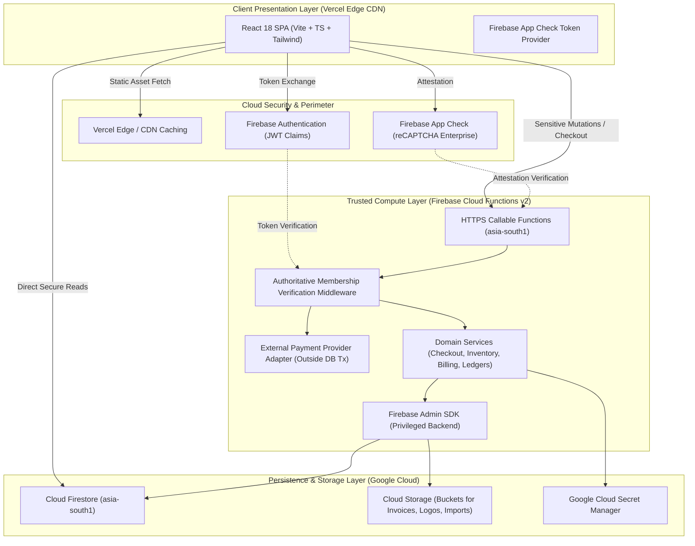
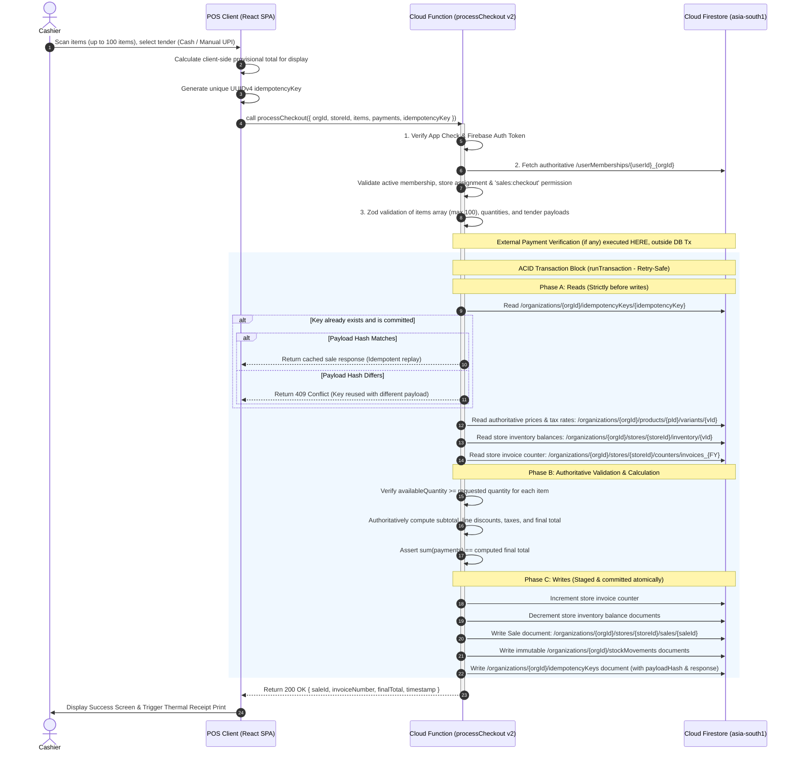

# Retail Sync — System Architecture

> **Document Status:** Complete & Authoritative (Phase 0 — Final Sign-Off)  
> **Target Audience:** Engineering, Solutions Architects, Infrastructure  
> **Last Updated:** 2026-11-20  

---

## 1. System Topology Overview

Retail Sync is designed as a **Multi-Tenant Cloud-Native Modular Monolith**. It pairs a high-performance Single Page Application (SPA) on modern edge CDN infrastructure with trusted serverless backend execution via Firebase Cloud Functions v2 and a partitioned Google Cloud Firestore NoSQL database.

---

## 2. Frontend vs. Backend Responsibility Matrix

To prevent business logic leakage, unauthorized discounts, and race conditions, Retail Sync enforces a strict division of responsibility between the client UI and the trusted serverless backend.

| Architectural Domain | Frontend (Client / React SPA) | Backend (Trusted Cloud Functions v2) |
| :--- | :--- | :--- |
| **Catalog & Inventory Browsing** | Reads cached catalog data directly from Firestore via real-time listeners or TanStack Query; provides optimistic UI filtering. | Restricts read queries via Firestore Security Rules so tenants cannot read foreign products. |
| **Cart & Pricing Computation** | Calculates *preview* totals, provisional discounts, and estimated taxes for instant UX feedback. Marked explicitly as `(Estimated)`. | **Authoritative Truth:** Re-fetches current active prices, active promotions, and tax brackets from database; calculates authoritative invoice total. |
| **Checkout & Payment Capture** | Collects payment tenders, captures cash tendered, or records manual UPI notes. Submits payload with idempotency key. Online connection mandatory. | **Atomic Transaction:** Validates stock levels, locks inventory, decrements balances, assigns sequential invoice ID, writes immutable sale record. |
| **Payment Verification** | Client captures manual reference or awaits gateway callback. | External payment provider calls are executed **outside** Firestore transactions. Webhook signature verification and ledger reconciliation occur server-side. |
| **Inventory Movement & Adjustment** | Submits stock count, transfer request, or scrap reason codes with quantity targets. | Computes stock differential, ensures source has adequate stock, writes immutable movement log, mutates balance atomically. |
| **Invoice Numbering & Fiscal Year**| Displays placeholder (e.g., `PENDING-SEQ`). | Enforces transactional, store-unique invoice generation using atomic counter documents per fiscal year. Failed transactions roll back without consuming numbers. |
| **Held Bills & Resumption** | UI displays active and parked carts. | Enforces application-level expiration check (`currentTime < expiresAt`) upon retrieval or checkout. Rejects expired bills. |
| **User & Tenant Management** | Provides UI for inviting store cashiers, managers, and assigning role selections. | Validates requester's organizational authority; updates authoritative `/userMemberships` records and issues custom claims. |

---

## 3. Firebase Service Architecture

### 3.1 Firebase Authentication & Membership Authoritativeness
- **Authentication:** Manages user identities using email/password (for managers/owners) and Phone Auth / PIN (for fast POS cashier terminals).
- **Authoritative Membership Principle:** Custom claims in the JWT (e.g., `orgId`, `defaultStoreId`, `role`) are used **only for client-side routing hints and low-privilege UI rendering**. The backend authoritatively fetches and validates the user's active membership document (`/userMemberships/{userId}_{orgId}`) for all privileged operations.

### 3.2 Cloud Firestore (NoSQL Document Store)
- **Deployment Region:** Regional Firestore in `asia-south1` (Mumbai).
- **Latency & Performance Reality:** Database latency is variable and dependent on network round-trip time, transaction contention, payload size, geographic routing, and cold starts. Latency SLAs are not guaranteed by default and must be benchmarked under simulated load during performance testing.
- **Direct Reads:** The frontend uses the Firebase Web SDK to read master catalog items, customer lookups, and configuration parameters directly, benefiting from Firestore's offline cache and real-time listeners.
- **Protected Writes:** All financial writes (sales, refunds, inventory balances, stock movements, invoice counters) are blocked in Security Rules from direct client mutation (`allow write: if false`). They are modified strictly via Cloud Functions utilizing the Firebase Admin SDK.

### 3.3 Firebase Cloud Functions v2 (Node.js 20 LTS)
- **Runtime:** Google Cloud Run-backed Functions v2, supporting concurrency (up to 80 concurrent requests per container instance), reducing cold-start frequency.
- **Execution Region:** Fixed to `asia-south1` matching Firestore location.
- **Retry-Safe Transaction Design:** Database transactions must be idempotent and free of non-idempotent side effects (e.g., sending SMS, triggering external payment API calls) because Firestore transactions can automatically re-execute up to 5 times upon document contention.

### 3.4 Firebase App Check
- **Attestation Provider:** reCAPTCHA Enterprise for web clients.
- **Enforcement:** Enforced on both Cloud Firestore rules and Cloud Functions entry points. Requests originating from unauthorized scrapers, curl scripts, or malicious bots without valid attestation are rejected at the edge.

---

## 4. End-to-End Request & Data Flow: POS Checkout

The Point of Sale checkout is executed via the `processCheckout` Cloud Function v2.

### 4.1 Transaction Design & Sequencing Rules
1. **Separation of External Calls:** External payment gateway calls (payment verification, charge captures) are executed **prior to or after** entering the Firestore transaction. No external HTTP requests are permitted inside `runTransaction`.
2. **Strict Read-Before-Write Ordering:** All document reads (idempotency key, product variants, store inventory balances, store invoice counter) are completed before any write operations are staged.
3. **Cart-Size Limits:**
   - **Standard Retail POS:** Up to **100 line items** per transaction are supported within a single atomic transaction. With line items, inventory balances, invoice counter, sale document, and stock movements, this stays well below Firestore's 500-write limit and 10 MB payload ceiling.
   - **Wholesale Bulk Orders (> 100 items):** Processed through staged multi-batch background operations with distinct locking semantics.
4. **Idempotency & Concurrency Resolution:**
   - Inside Firestore transactions, uncommitted writes are isolated and not observable to concurrent transactions.
   - When concurrent requests arrive with the same idempotency key, one transaction commits first, writing `/idempotencyKeys/{key}` with `requestPayloadHash`, `saleId`, and `responsePayload`.
   - The other concurrent transaction experiences contention on the counter or idempotency document, automatically rolls back, and retries.
   - On retry, it reads the committed idempotency document:
     - **Matching Payload Hash:** Returns the original stored sale confirmation immediately (200 OK) without deducting stock or burning an invoice number.
     - **Conflicting Payload Hash:** Rejects immediately with `409 Conflict: Idempotency Key Reused with Different Payload`.
5. **Transactional Invoice Numbering & Fiscal Year:**
   - Counter document `/organizations/{orgId}/stores/{storeId}/counters/invoices_{fiscalYear}` is read and incremented inside the transaction.
   - Default fiscal year: April 1 to March 31 (`2026-2027`). Configurable alternative: January 1 to December 31 (`2026`). Changing fiscal year after invoices exist requires authorized administrative intervention.
   - If the transaction aborts due to stock shortages or contention, the counter is not committed and no number is consumed.
   - Committed invoice numbers are never reused. If an order is canceled post-commit, a reversal record (Credit Note) is generated referencing the original invoice.

---

## 5. Offline Behavior & Boundary Definition

1. **Mandatory Online Connectivity for Checkout:** To enforce strict server-side pricing, inventory decrements, and transactional invoice numbering, **an active internet connection is mandatory to finalize checkout**.
2. **Transient Network Resilience & Held Bill Lifecycle:**
   - If the network drops while composing a cart, the client can park the active cart locally in browser storage or save it to `/organizations/{orgId}/stores/{storeId}/heldBills/{id}` once connection recovers.
   - **Expiration Policy:** Default expiration is 24 hours (configurable by organization between 1 and 72 hours).
   - **Enforcement:** The backend/application explicitly verifies `currentTime < expiresAt` upon retrieval and checkout. Expired bills are rejected (`410 Gone: Held Bill Has Expired`).
   - **Firestore TTL Role:** Native Firestore TTL on `expiresAt` is used purely for eventual asynchronous cleanup and storage optimization, not as the real-time business enforcement mechanism.
   - Held bills do not reserve inventory and do not consume invoice numbers.
3. **No Offline Financial Synchronization:** Synchronizing financial transactions completed offline is explicitly out of scope for the initial release to eliminate the risk of negative inventory race conditions, invoice number collisions, and pricing discrepancies.

---

## 6. Performance Expectations & Testing Requirements

1. **Latency Variables:**
   - Real-world API response time is a function of client internet connection (3G/4G/fiber), TLS negotiation overhead, Cloud Functions cold start vs. warm instance latency, payload size, and Firestore multi-tenant resource scheduling.
   - Sub-5ms database latency claims are unrealistic across distributed internet hops and are removed.
2. **Performance Benchmarking Requirements:**
   - **Target SLA:** P95 checkout round-trip latency under 1,500ms on a standard broadband connection.
   - **Load Testing Plan:** Automated benchmarking using k6/Artillery against the Firebase Emulator and Staging environments simulating 50 concurrent store checkouts prior to production launch.
